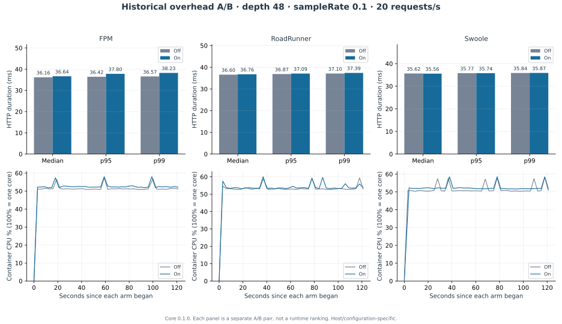
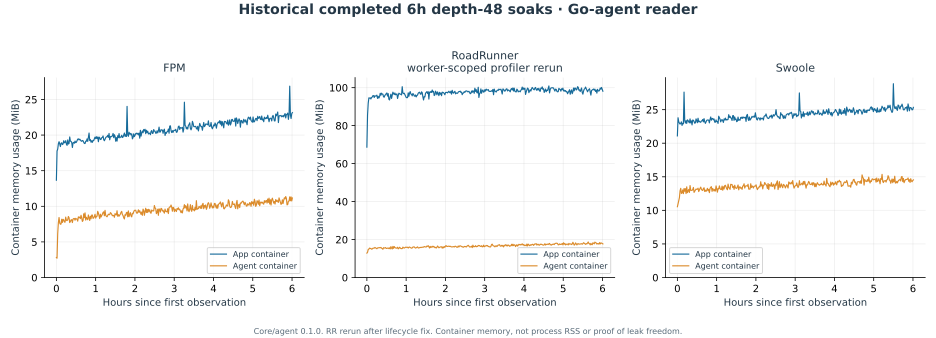

# Tracewick Benchmarks

Load tests, soak runs, and reproducible benchmark stands for [Tracewick](https://github.com/tracewick/tracewick) — reports, charts, and an environment anyone can spin up to verify results.

This is a **sibling** of the library repo. Capacity / soak / load harness lives here. The library keeps only short summaries, selected screenshots, and a link.

Packagist: [`tracewick/tracewick`](https://packagist.org/packages/tracewick/tracewick) (pin recorded in every report).

## Quick start

Prerequisites: Docker with Compose v2, outbound network for the first image build (Packagist + pecl Excimer).

```bash
git clone https://github.com/tracewick/benchmarks.git
cd benchmarks
cp .env.example .env   # optional
make up                # build + Pyroscope + Grafana + PHP workload + drain
make bench-smoke       # wiring smoke (profiles → Pyroscope)
make bench-overhead    # M2: baseline vs on @ fixed RPS (~2× duration)
# Long soaks run separately: see docs/soak.md for pins and the pilot.
make down
```


| URL | What |
| --- | --- |
| http://127.0.0.1:8080/health | Workload liveness |
| http://127.0.0.1:8080/work | Profiled work unit |
| http://127.0.0.1:3000 | Grafana (anonymous Admin). **Explore → Profiles** (or Drilldown → Profiles), service `benchmarks-workload` |
| http://127.0.0.1:4040 | Pyroscope |

Pinned k6: `grafana/k6:1.8.2` (`make k6-version`). First `make up` compiles Excimer via PECL and may take several minutes.

## Documentation

| Doc | Purpose |
| --- | --- |
| [METHOD.md](METHOD.md) | How we measure (canon) |
| [LIMITATIONS.md](LIMITATIONS.md) | What we do not claim |
| [CONTRIBUTING.md](CONTRIBUTING.md) | How to change this repo |
| [scenarios/](scenarios/) | Named profiles |
| [reports/](reports/) | Checked-in reports + template |

The [PHP ZTS/ext-parallel experiment](reports/2026-11-19-zts-parallel.md) records
passing thread-local Excimer/Tracewick collection/spool checks and a separate Future
result-transfer crash outside the profiling path. It is exploratory compatibility evidence,
not a capacity or overhead result.

## Recorded overhead and long-run behavior

**Historical measurements on core/agent 0.1.0, not current-version performance claims.**
These figures show the saved November 6–8 runs and their recorded configurations.



Each runtime has its own off/on pair at 20 requests/s, depth 48 and sample rate 0.1.
Worker configurations differ; this is not a cross-runtime ranking. Sources:
[FPM](reports/2026-11-06-overhead-depth48-cloud.md),
[RoadRunner](reports/2026-11-07-overhead-rr-agent-depth48-cloud.md),
[Swoole](reports/2026-11-07-overhead-swoole-agent-depth48-cloud.md).



All saved observations from completed six-hour depth-48 soaks are shown, including startup.
Changes between **first-hour and last-hour average** app-container usage were FPM **+3.6 MiB**,
RoadRunner **+3.4 MiB**, and Swoole **+1.9 MiB**.
RoadRunner is the November 8 rerun **after reusing one profiler per worker**; the earlier
per-request-construction run (~+1 GiB / 6h) is not included or retained in these artifacts.
These are **container memory usage**, not PHP process RSS. The small increases do not establish
a process leak, prove leak freedom, or replace the separate 72-hour test. Sources:
[FPM](reports/2026-11-07-soak-fpm-agent-depth48-cloud.md),
[RoadRunner](reports/2026-11-08-soak-rr-agent-depth48-cloud.md),
[Swoole](reports/2026-11-07-soak-swoole-agent-depth48-cloud.md).

Each report also has its own figure. See [plot reproduction and provenance](docs/report-plots.md).

## Layout

```
stand/           compose support + PHP workload (Packagist Tracewick)
generators/k6/   primary load scripts
scenarios/       scenario catalog
reports/         checked-in reports; local scratch under reports/_local/
```

## Make targets

| Target | Meaning |
| --- | --- |
| `make build` | Build PHP-FPM + nginx images |
| `make up` | Build + start full smoke stand |
| `make up-chaos` | Also start Toxiproxy |
| `make down` | Stop and remove volumes |
| `make k6-version` | Print / run pinned k6 image |
| `make bench-smoke` | Short k6 smoke + Pyroscope app check |
| `make bench-overhead` | M2 A/B at `RATE` req/s (default 20) for `DURATION` (default `2m`) |
| `make bench-spool-pressure` | M3: stop drain, fill spool, measure catch-up |
| `make bench-chaos` | M3: Toxiproxy latency toward Pyroscope |
| `make bench-soak` | Observed soak: explicit pins, RR/agent by default; [runbook](docs/soak.md) |
| `make bench-rps` | High-RPS pipeline: deep stacks + spool series (default `500` / `5m`) |
| `make collect-report` | Stash host meta under `reports/_local/` |

### Observed soak (manual)

Follow [docs/soak.md](docs/soak.md): explicit source pins → short pilot → calibrated
72-hour run under tmux. The runner starts its own Compose project; do not run
`make up` alongside it on the same ports. Defaults: RR/agent, one RR worker,
depth 48, sample rate 0.1, 15-second telemetry. Raw evidence and validity/resource
reports are under `reports/_local/soak-<utc>/`. `make check-soak` runs regression
checks; `make plot-soak RUN_DIR=...` renders preserved telemetry.

### High-RPS pipeline (manual)

Uses the same `/work` wall budget (`WORK_BUSY_MS` / `WORK_SLEEP_MS`) as overhead/soak. Opt-in `WORK_STACK_DEPTH` deepens call stacks so spool payloads are larger (closer to a real app). Other legacy scenarios keep `WORK_STACK_DEPTH=0`; observed soak defaults to 48.

**Honesty:** these runs are **one instance** (typically app + drain + Pyroscope + k6 on a single VPS). The sustained RPS you publish is the **ceiling of that server configuration and synthetic work unit**, not “Tracewick handles N RPS everywhere” and not a multi-node fleet result. On the Timeweb 8 vCPU stand with depth-48 `/work` (~25 ms busy + 10 ms sleep, 32 FPM workers), overload probes showed ~760 achieved RPS with multi-second latency — so a clean hold is expected around **~700 RPS**, not 1.5–3k.

```bash
cd /root/benchmarks && git pull --ff-only
# first time after pull: rebuild FPM image (entrypoint / max_children)
make up
RATE=700 DURATION=5m PRE_VUS=500 MAX_VUS=2000 make bench-rps
# optional admission stress: READER=off RATE=700 DURATION=2m ...
# go-agent sidecar (alpha 0.1.0) instead of PHP drain:
# READER=agent WORK_STACK_DEPTH=48 RATE=700 DURATION=5m make bench-rps
# RoadRunner (same /work + UnitOfWorkProfiler; not ContinuousProfiler):
# make up-rr READER=agent
# RUNTIME=rr READER=agent BASE_URL=http://127.0.0.1:8082 WORK_STACK_DEPTH=48 \
#   RR_NUM_WORKERS=32 RATE=700 DURATION=5m make bench-rps
# Swoole (ContinuousProfiler + SpoolSink):
# make up-swoole READER=agent
# RUNTIME=swoole READER=agent BASE_URL=http://127.0.0.1:8083 WORK_STACK_DEPTH=48 \
#   SWOOLE_WORKER_NUM=32 RATE=700 DURATION=5m make bench-rps
```

Artifacts: `reports/_local/rps-pipeline-<utc>/` and `rps-pipeline-latest.md`. Checked-in reports must repeat the single-instance / host-ceiling caveat. `READER=drain|agent|off` (default `drain`). `RUNTIME=fpm|rr|swoole` (default `fpm`).

Post-fix [exact signal-weight verification](reports/2026-11-17-signal-weights.md)
checks native events through CLI/FPM/RR, spool, agent pprof and live Pyroscope.
It is correctness evidence, not a replacement for the capacity reports below.
Those reports predate the explicit-flush fix; do not reuse their absolute profile
weights as post-fix evidence or apply a blanket divide-by-two correction.

The separate [known-function share experiment](reports/2026-11-18-profile-shares.md)
checks wall-time proportions against independently measured function durations.
Its [runbook](scripts/share-accuracy/README.md) defines the fixed matrix and limits.

The [72-hour RR and Go-agent soak](reports/2026-11-22-soak-rr-agent-72h.md)
records continuous depth-48 operation on the November fixes, with per-process
resources, cgroup metrics, delivery evidence and the preceding observer failure.

The [development runtime preflight](reports/2026-11-22-development-runtime.md)
records current develop sources, repeated fixed-operation CPU measurements,
backend/reader recovery and real Symfony HTTP/CLI/Messenger checks. It separates
runtime results from the unresolved source-1.0 package constraint and from any
future published-RC installation check.

Local run scratch: `reports/_local/`. **Canonical** cloud goldens (cite these — `WORK_STACK_DEPTH=48` on the 8 vCPU stand, except soak):

- [overhead A/B](reports/2026-11-06-overhead-depth48-cloud.md)
- [spool pressure (PHP drain)](reports/2026-11-06-spool-pressure-depth48-cloud.md)
- [spool pressure (go-agent) — ~2s catch-up](reports/2026-11-06-spool-pressure-agent-depth48-cloud.md)
- [chaos Pyroscope (PHP drain)](reports/2026-11-06-chaos-pyroscope-depth48-cloud.md)
- [chaos Pyroscope (go-agent)](reports/2026-11-06-chaos-pyroscope-agent-depth48-cloud.md)
- [high-RPS ~700 (PHP drain, soft admission)](reports/2026-11-06-rps-pipeline-cloud.md)
- [high-RPS ~700 (go-agent, spool below ceiling)](reports/2026-11-06-rps-pipeline-agent-depth48-cloud.md)
- [overhead A/B (RoadRunner × agent)](reports/2026-11-07-overhead-rr-agent-depth48-cloud.md)
- [high-RPS ~700 (RoadRunner × agent)](reports/2026-11-07-rps-pipeline-rr-agent-depth48-cloud.md)
- [overhead A/B (Swoole × ContinuousProfiler × agent)](reports/2026-11-07-overhead-swoole-agent-depth48-cloud.md)
- [high-RPS ~700 (Swoole × ContinuousProfiler × agent)](reports/2026-11-07-rps-pipeline-swoole-agent-depth48-cloud.md)
- [soak 6h (FPM × agent, depth-48)](reports/2026-11-07-soak-fpm-agent-depth48-cloud.md) — stable
- [soak 6h (RoadRunner × agent, depth-48)](reports/2026-11-08-soak-rr-agent-depth48-cloud.md) — stable (after worker-scoped profiler)
- [soak 6h (Swoole × ContinuousProfiler × agent, depth-48)](reports/2026-11-07-soak-swoole-agent-depth48-cloud.md) — stable
- [soak 72h (FPM static + drain, shallow)](reports/2026-11-03-soak-cloud.md) — historical

Historical (Nov-3, depth `0`, 2 vCPU — kept for depth/host comparison, **not** for citing SLOs):

- [overhead A/B shallow](reports/2026-11-03-overhead-cloud.md)
- [spool pressure shallow](reports/2026-11-03-spool-pressure-cloud.md)
- [chaos Pyroscope shallow](reports/2026-11-03-chaos-pyroscope-cloud.md)


## Boundary with the library

| Here | There (`tracewick/tracewick`) |
| --- | --- |
| Capacity compose, k6, scenarios, reports | Unit / integration / Infection / smoke wiring |
| Long-lived charts and raw artifacts | Brief docs blurb + link + a couple of screenshots |
| Depend on Packagist / pinned git ref | Do not accept “add 10k RPS k6” PRs into the library |

## License

[Apache-2.0](LICENSE), same as Tracewick.
