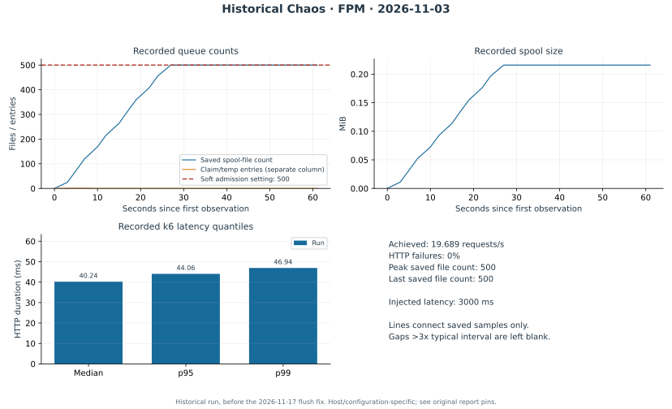

# Report: chaos Pyroscope latency — 2026-11-03

| Field | Value |
| --- | --- |
| Toxic | latency 3000ms on toxiproxy→pyroscope |
| RATE / duration | 20 / 60s |
| sampleRate | 1.0 |
| Peak spool files during toxic | 500 |
| HTTP fail rate | 0 |

App requests should remain healthy while delivery slows and spool grows.

<!-- saved-results-plot -->
## Recorded results at a glance

Historical saved measurements on the versions/configuration in this report; no current-version performance claim. Lines connect recorded samples; gaps over three typical intervals are not connected.
<!-- /saved-results-plot -->
