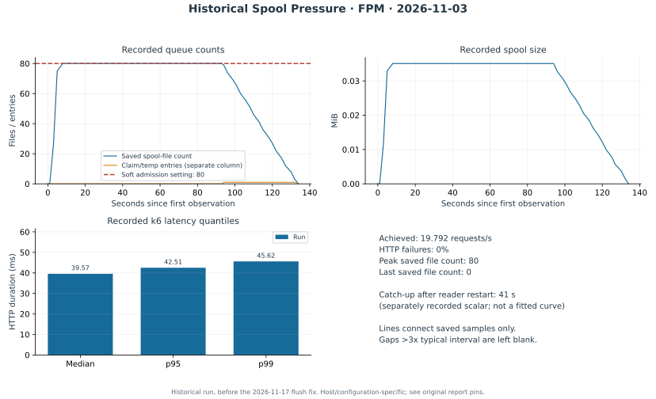

# Report: spool pressure — 2026-11-03

Methodology: [METHOD.md](../../METHOD.md) layer B.

## Setup

| Field | Value |
| --- | --- |
| Host run dir | `/root/benchmarks/reports/_local/spool-pressure-20261103T100253Z` |
| sampleRate | `1.0` |
| TRACEWICK_SPOOL_MAX_FILES | `80` |
| RATE / duration | 20 / 90s |
| Drain during load | **stopped** |

## Results

| Metric | Value |
| --- | --- |
| Peak spool files | 80 (cap 80) |
| HTTP fail rate during fill | 0 |
| Achieved RPS | 19.79202282635529 |
| Drain catch-up | see `drain-catchup.txt` |

## Interpretation

- Spool grew while drain was down; HTTP should stay green (fail-open / soft admission).
- Peak near `max_files` implies further profiles were dropped at admission (soft).
- After drain restart, queue should shrink (catch-up lag).

## Artifacts

- `k6.json`, `spool-timeseries.csv`, health + spool snapshots in this directory.

<!-- saved-results-plot -->
## Recorded results at a glance

Historical saved measurements on the versions/configuration in this report; no current-version performance claim. Lines connect recorded samples; gaps over three typical intervals are not connected. Catch-up annotation comes from the saved restart measurement; no synthetic drain curve is added.
<!-- /saved-results-plot -->
