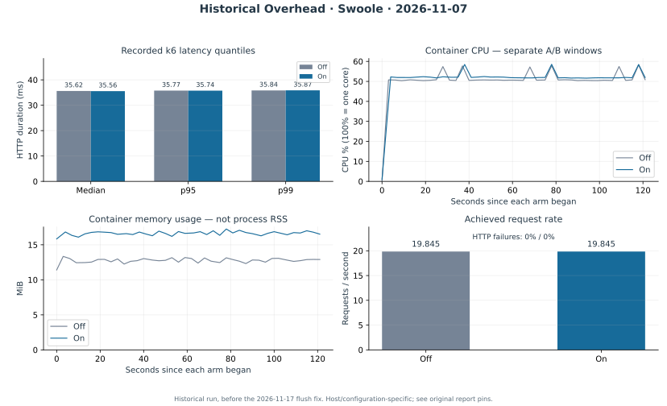

# Report: overhead A/B — 2026-11-07 (Swoole × ContinuousProfiler × agent, depth-48)

Methodology: [METHOD.md](../METHOD.md). Limitations: [LIMITATIONS.md](../LIMITATIONS.md).

Raw artifacts: [2026-11-07-overhead-swoole-agent-depth48-cloud/](./2026-11-07-overhead-swoole-agent-depth48-cloud/).

Same `/work` unit as FPM/RR depth-48; runtime = **Swoole**, profiler = **ContinuousProfiler** (always-on when enabled — no request `sampleRate`), reader = **go-agent 0.1.0**.

## Results

| Metric | baseline (off) | on | delta |
| --- | --- | --- | --- |
| Latency med / p95 / p99 | 35.62 / 35.77 / 35.84 ms | 35.56 / 35.74 / 35.87 ms | **≈0 / ≈0 / +0.03 ms** |
| HTTP fail | 0% | 0% | |
| app-swoole CPU avg | 50.4% | 51.2% | **+0.8 pp** |

At 20 RPS the ContinuousProfiler path is noise-level vs off on this stand (same order as RR UnitOfWork deltas).

## Pins

`RUNTIME=swoole`, `READER=agent`, `WORK_STACK_DEPTH=48`, `SWOOLE_WORKER_NUM=4`, 20 RPS / 2m each arm, Packagist `0.1.0`, 8 vCPU Timeweb.

<!-- saved-results-plot -->
## Recorded results at a glance

Historical saved measurements on the versions/configuration in this report; no current-version performance claim. Lines connect recorded samples; gaps over three typical intervals are not connected. Memory is container usage from saved docker stats, not per-process RSS or proof of leak freedom.
<!-- /saved-results-plot -->
