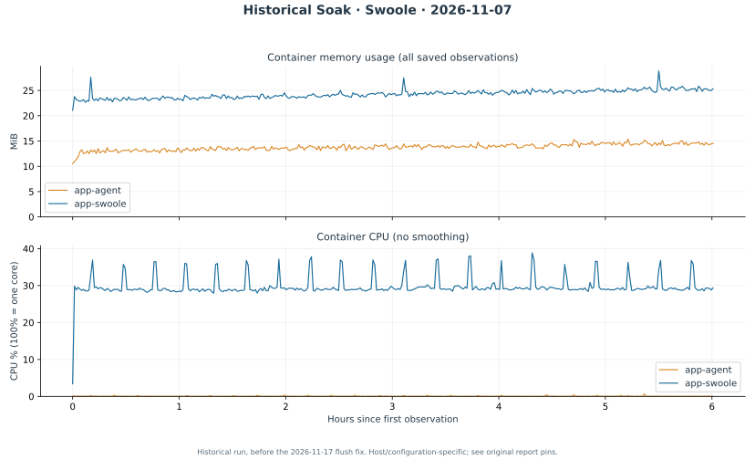

# Report: soak 6h — 2026-11-07 (Swoole × ContinuousProfiler × agent, depth-48)

Methodology: [METHOD.md](../METHOD.md). Limitations: [LIMITATIONS.md](../LIMITATIONS.md).

Raw artifacts: [2026-11-07-soak-swoole-agent-depth48-cloud/](./2026-11-07-soak-swoole-agent-depth48-cloud/).

## Results

| Service | RSS first → last | Δ | Verdict |
| --- | --- | --- | --- |
| app-swoole | 23.3 → 25.2 MiB | **+1.9 MiB** (+8%) | **stable** |
| app-agent | 12.9 → 14.5 MiB | **+1.6 MiB** (+12%) | **stable** |

k6: ~10 RPS, **0%** fail. ContinuousProfiler + agent look clean on this 6h window.

## Pins

`RUNTIME=swoole`, `READER=agent`, `WORK_STACK_DEPTH=48`, `SWOOLE_WORKER_NUM=8`, 10 RPS / 6h, sampleRate 0.1.

<!-- saved-results-plot -->
## Recorded results at a glance

Historical saved measurements on the versions/configuration in this report; no current-version performance claim. Lines connect recorded samples; gaps over three typical intervals are not connected. Memory is container usage from saved docker stats, not per-process RSS or proof of leak freedom.
<!-- /saved-results-plot -->
