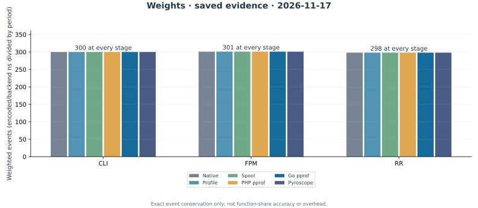

# Signal weights after the Excimer explicit-flush fix

Date: 2026-11-17. Method: [METHOD.md](../METHOD.md), layer C; executable
[probe/runbook](../scripts/signal-weight/README.md).

## Question and result

Does the merged explicit-flush fix preserve the native event count through UoW,
compact spool, agent aggregation/encoding, and live Pyroscope readback?

**PASS for these short synthetic CLI/FPM/RR runs.** For each runtime, ten spool
files were aggregated into one agent push and acknowledged. Native event counts,
profile/spool weights, both pprof encoders' totals, and the backend total agreed
exactly. `signalWork` appears in the returned flamegraph. RR used one worker for
all ten requests; FPM used two pool workers.

| Runtime | Units | Native / profile / spool events | PHP pprof ns | Agent pprof ns | Pyroscope ns |
| --- | ---: | ---: | ---: | ---: | ---: |
| CLI | 10 | 300 | 300,000,000 | 300,000,000 | 300,000,000 |
| FPM | 10 | 301 | 301,000,000 | 301,000,000 | 301,000,000 |
| RoadRunner | 10 | 298 | 298,000,000 | 298,000,000 | 298,000,000 |

Machine-readable [summary](2026-11-17-signal-weights/summary.json), JSONL native
capture manifests, raw agent pprof + `go tool pprof -raw` output, and Querier
responses are in [the evidence directory](2026-11-17-signal-weights/).

## Pins and environment

- Library: `6cd62b169b999f8b52e178778603f661d907d9aa` (develop merge of PR #78).
- Agent: `f4982bdcc9afb4a36a1931a8a6385110c30987ba` (0.2.1 source checkout).
- Benchmarks base: `e43a37a`; verification harness added in this PR.
- Host: managed Linux cloud workspace, Linux 6.18.57, 3 logical CPUs visible;
  shared host, no CPU affinity/limits or capacity equivalence claimed.
- PHP FPM/CLI: 8.5.12; Excimer 1.2.7, source
  `23f541b9d970db0524a1b2506b4df727e5e59998`.
- RoadRunner: 2025.1.15, one worker; PHP client versions pinned in the harness
  composer.lock. FPM default dynamic pool, two observed worker PIDs.
- Pyroscope: `grafana/pyroscope:2.4.2`, real local backend, fresh disposable
  instance with proxy bypass for internal RPC.
- Go: 1.27.4 (`go tool pprof` independently decoded all three agent captures).
- Runtime image built by the checked-in Dockerfile:
  `sha256:9c205c1a0cb6546fdca9629ade14c1462820d50f273204afe9bf4ef2fdfcd48d`.
  [Image identities](2026-11-17-signal-weights/images.json) record the concrete
  runtime and available upstream image digests. The complete runbook was executed
  from a fresh set of the three disposable containers.
- Work: ten serial units/runtime, ~30 ms busy work/unit, sampleRate=1.0,
  wall period 1,000,000 ns, maxSamples=100,000. Direct FastCGI requests to real
  FPM; real RR HTTP on loopback; CLI uses a persistent profiler across units.

## What the harness measures

Before UoW stop, it stops native sampling and reads the pending Excimer log's
actual weighted event count. It captures the finished Profile and inspects every
spool file. Both PHP-produced pprof and intercepted agent pprof are decoded by a
separate Python wire reader. Live Querier total provides the final check.
The proxy forwards original push bytes and only records accepted profiles.

This intentionally freezes the sampler to avoid racing the expected count. It
is a controlled correctness experiment, not an uninstrumented production path.
Test workers/readers run as root for restricted cloud checkout access; production
UID compatibility is not tested here.

## Negative control

The same CLI capture with the pre-fix `ExcimerSampler` loaded before autoloading
fails immediately with `Native/profile mismatch: 30 vs 60`. The baseline source
is from library commit `97b6dd7b1b119555eee6945d03537879e7703334`; the sampler was
loaded via PHP `auto_prepend_file`, with the rest of the harness unchanged. This
is a detected counting error, not a comparison of independently sampled runs.
The final fixed-code run passes the exact oracle for every unit.

## Limits and implications for older reports

This does **not** establish overhead, latency, sampling accuracy, leak freedom,
72h stability, or production readiness. It is shorter than the standard k6 smoke
and uses no load generator: the goal is exact arithmetic, not capacity.
Automatic native segments and duration rotation remain covered by the library's
real-extension integration tests, not by this deliberately high-threshold probe.

Older reports predate the fix and may contain inflated profile weights on the
explicit-flush path. The error depends on which events were ingested by threshold
callbacks versus explicit flushes; there is no justified blanket “divide by two”
correction. Historical evidence is retained. Their absolute signal/weight claims
must not be reused as post-fix evidence. CPU/latency observations remain historical
measurements of their pinned code; remeasure before asserting current overhead.
This report does not invalidate every historical number or silently recalculate it.

<!-- saved-results-plot -->
## Recorded results at a glance

Exact event conservation only; not function-share accuracy or overhead.
<!-- /saved-results-plot -->
