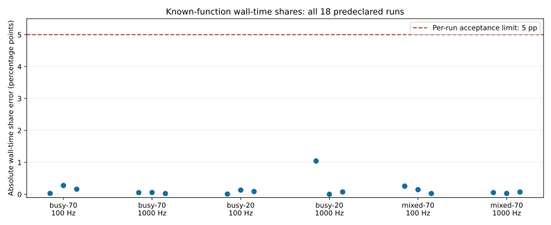

# Known-function wall-time shares

Date: 2026-11-18. Method: [METHOD.md](../METHOD.md), controlled signal-share experiment;
[executable runbook](../scripts/share-accuracy/README.md).

## Result

**PASS for all 18 predeclared CLI runs.** Actual Pyroscope inclusive phase weights are within
5 percentage points of independent elapsed-time measurements in every run. Maximum absolute
error: **1.044 pp**; median: **0.066 pp**.
Maximum weight outside the two phase markers: **0.183%**
(limit 1%). Each run exceeds its weighted-volume floor. Swapping the two phase weights preserves
the total but fails the share check in **18/18** negative controls.

This is evidence about the measured develop snapshots, not a selection or certification of the
future RC. No profiler, agent or Symfony production code was changed by this experiment.
The completed total-weight conservation campaign was not rerun.

## Revisions and environment

- Core: `37e5928506cee2b1c395c2c8d01e89f2bf43a6b8`.
- Agent: `a15f0d310ba6d5942e67b37d3c3c55dc1b3b8100`; Go 1.27.4.
- Benchmarks base: `472be2566a1d03d0f5f636b31ea7e84dca0f73c1`; added harness input SHA-256s
  are recorded in the [manifest](2026-11-18-profile-shares/manifest.json).
- Managed shared Linux host: kernel 6.18.57, x86_64, three logical CPUs visible, no affinity
  or CPU limits imposed for this experiment. No capacity equivalence or resource-isolation claim.
- Docker 29.9.2; Python 3.12.14; PHP CLI 8.5.12; Excimer 1.2.7; OPcache CLI off, JIT disabled.
- PHP image used locally: `tracewick-uow-php:8.5`, ID
  `sha256:87fc0fefa75d730cc8f56072ad2c5fc66996a52f6a27d8c72009fb35130bb5fb`. The runbook supports the normal core stand image via
  `--php-image`; it need not share this locally assigned tag.
- Pyroscope 2.4.3, default segment-writer path, isolated fresh container; ID
  `sha256:d7642a49eb85faf046ac286b40881cb6e55dc6a2a2e008a2468816e676dfd2e9`; image digest
  `sha256:bf667534cd403320573063894e3faba20a5a5d1bfb92eddaecfabeb2446c502b`.
- Run ID `20261118T114657Z`. User-matched CLI container and Go reader; no FPM/RR server.

## Fixed method

The matrix contains PHP/PHP 70:30, PHP/PHP 20:80 and PHP/usleep 70:30 workloads, each at
100/1000 Hz and three deterministic repetitions. Every repetition starts a fresh process,
warms both functions, then records at least 40/12 seconds respectively. Native flush threshold
1000 exercises normal log callbacks; sampleRate is 1.0 and the UoW duration-rotation setting
remains its default off. There is no sampler freeze, native-log oracle or callback replacement.

Each cycle randomizes phase order and jitters requested duration over 20–80 ms. The oracle
measures wall time around each marked function call with hrtime. This includes actual sleep
overshoot, descheduling and profiler work that occurs during the call. Expected shares use those
**measured** durations, not the nominal 70/30 or 20/80 request. The source sink's counts are only
diagnostics, not the ground truth for share accuracy.

A real Go agent delivers each unique service to live Pyroscope. Analysis uses inclusive weights
below mutually exclusive `shareAlpha` / `shareBeta` nodes, including nested VM-interrupt callback
frames. It bounds unclassified weight separately before accepting normalized shares. The
measured function shares and actual backend shares are tabulated below. As an additional
readback check, source and Pyroscope alpha/beta/other weights match exactly in every run.

100 Hz requires at least 3000 classified weighted periods; 1000 Hz requires 9000. Observed
weight/period is not a count of independent Bernoulli trials, especially around a C call.
No binomial confidence interval is claimed. Acceptance is per individual run; neither the
median nor a pooled total can hide a failed repetition. Integer cross-products implement the
inclusive 5 pp / 1% boundaries without floating-point acceptance drift.

## All runs

| Case | Measured alpha % | Pyroscope alpha % | Error pp | Other % | Weighted periods |
| --- | ---: | ---: | ---: | ---: | ---: |
| busy-20-1000hz-r1 | 19.897 | 20.941 | 1.044 | 0.183 | 12005 |
| busy-20-1000hz-r2 | 19.995 | 19.997 | 0.002 | 0.017 | 12012 |
| busy-20-1000hz-r3 | 20.105 | 20.180 | 0.075 | 0.025 | 12007 |
| busy-20-100hz-r1 | 20.036 | 20.045 | 0.009 | 0.000 | 4001 |
| busy-20-100hz-r2 | 19.998 | 20.130 | 0.132 | 0.025 | 4004 |
| busy-20-100hz-r3 | 20.062 | 20.150 | 0.088 | 0.000 | 4000 |
| busy-70-1000hz-r1 | 69.538 | 69.485 | 0.054 | 0.041 | 12066 |
| busy-70-1000hz-r2 | 69.985 | 69.927 | 0.058 | 0.042 | 12024 |
| busy-70-1000hz-r3 | 70.000 | 70.025 | 0.025 | 0.042 | 12030 |
| busy-70-100hz-r1 | 69.980 | 70.010 | 0.030 | 0.050 | 3998 |
| busy-70-100hz-r2 | 69.985 | 70.262 | 0.277 | 0.025 | 4005 |
| busy-70-100hz-r3 | 69.891 | 69.730 | 0.161 | 0.025 | 4004 |
| mixed-70-1000hz-r1 | 69.854 | 69.799 | 0.055 | 0.058 | 11993 |
| mixed-70-1000hz-r2 | 69.077 | 69.048 | 0.029 | 0.041 | 12051 |
| mixed-70-1000hz-r3 | 69.906 | 69.979 | 0.073 | 0.017 | 12005 |
| mixed-70-100hz-r1 | 69.899 | 69.642 | 0.256 | 0.075 | 3999 |
| mixed-70-100hz-r2 | 69.669 | 69.815 | 0.146 | 0.075 | 4002 |
| mixed-70-100hz-r3 | 69.830 | 69.855 | 0.025 | 0.025 | 4004 |

## Evidence and validation

- [Manifest / seeds / image IDs / input hashes](2026-11-18-profile-shares/manifest.json).
- [Complete summary and every negative control](2026-11-18-profile-shares/summary.json).
- [Compressed raw oracle and backend responses for every case](2026-11-18-profile-shares/evidence.json.gz).
  `gzip -dc reports/2026-11-18-profile-shares/evidence.json.gz` yields a JSON object keyed by case ID;
  each entry contains spec, complete per-cycle oracle, ProfileTypes, Querier response and result.
- All 18 cases and all 18 total-preserving swapped-symbol negative controls were retained.
- Local Python regression suite: 30 tests pass, including 14 share-check/matrix cases. PHP
  syntax, Python compilation, existing shell checks, Compose configuration and diff checks pass.
- Cold-backend setup probes are excluded from this complete matrix: one short 2-second probe
  correctly failed the weighted-volume floor; initial readback needed more time than expected.
  HTTP readiness did not imply immediate profile visibility. The final run allows 300 seconds
  for backend readback; that wait occurs after sampling and changes no accuracy threshold.

## Limits

This establishes aggregate **wall-time** attribution for these selected CLI workloads on the
recorded revisions. The oracle describes the profiled execution, not a separate unprofiled CPU
baseline. `usleep` exercises weighted VM-interrupt attribution after a C wait; it does not prove
arbitrary PDO/curl timelines or remove core ADR 11's resolution limit.

There is no claim about CPU-mode accuracy, low-rate request selection, arbitrary stack depths,
FPM/RoadRunner/Swoole share accuracy, overhead, latency, production UID behavior elsewhere,
long-term stability or universal <=5 pp error. The working 72h soak VPS was not contacted or
modified. Its eventual result remains separate. Revisit affected measurements if final-RC
changes alter sampling, stack conversion, aggregation or encoding.
