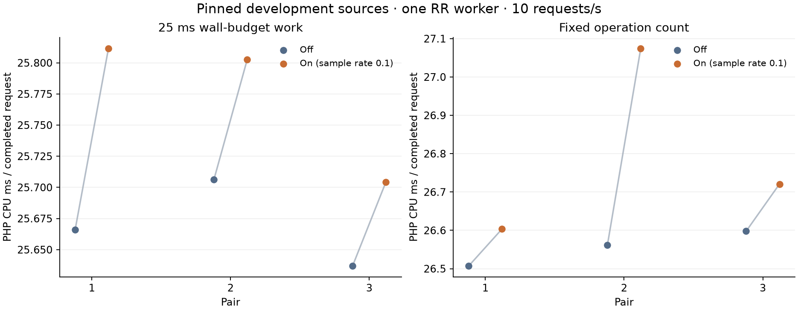
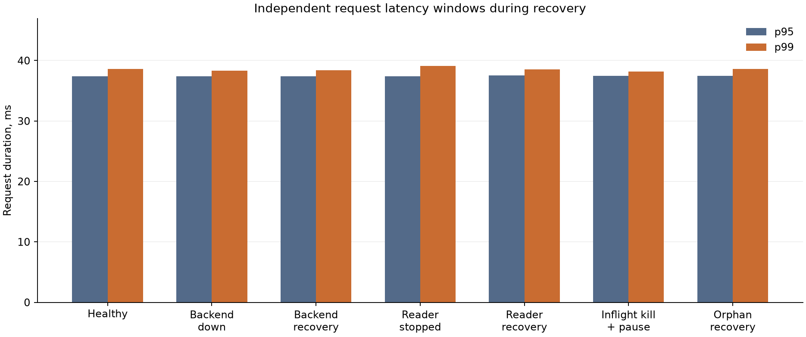

# Development runtime preflight

Methodology follows [METHOD.md](../METHOD.md), the [runtime preflight
runbook](../scripts/runtime-preflight/README.md), and
[LIMITATIONS.md](../LIMITATIONS.md).

## Verdict

**The scoped runtime scenarios passed on these development pins.** Backend outage,
reader restart and actual orphaned-claim recovery preserved application continuity
and ended with an empty spool. Real Symfony HTTP/CLI/Messenger behavior and
end-to-end delivery passed. The repeated real-Excimer suite passed 83 tests and 240
assertions, with no skips.

The fixed-operation CPU estimate has a paired median of **+0.462%**, with a **+0.363%
to +1.929%** observed range at sample rate 0.1. P99 increases are 0.769–1.933 ms.
These are synthetic workload measurements, not a universal performance guarantee.
Messenger memory requires the separate fixture-history interpretation below.

**The original-metadata source-1.0 Composer probe fails.** Bundle develop still
requires core `^0.2`; [Symfony PR
#25](https://github.com/tracewick/symfony-bundle/pull/25) contains the proposed
compatibility change. No published RC installation or release-artifact verification
has been completed because an RC was not published.

## Source scope

These are pinned development-source checks performed before an RC was published. The
remote develop heads were checked again during the campaign and matched the pins
below. No release tag, published RC archive, signature or SBOM was tested. The
[completed 72-hour soak](2026-11-22-soak-rr-agent-72h.md) used older source pins; its
duration does not transfer to the development snapshots in this report.

| Input | Pin |
| --- | --- |
| Core develop | `edb24275b48b6145216e8f8af34304819adf64f1` |
| Agent develop | `d464fac4a69a57b36dd171841012e69f3f5536ed` |
| Symfony bundle develop | `7928d3e69e480603442088ae2d4786d9a7ebccf1` |
| Excimer | 1.2.7, source `23f541b9d970db0524a1b2506b4df727e5e59998` |
| PHP / RR | 8.4.27 / 2025.1.15 |
| Symfony | 7.4.23 |
| Pyroscope / k6 | 2.4.2 / 1.8.2 |
| Benchmarks: wall-budget, recovery, Symfony | `7bf6893eb21a9d663048b0d4df632e0f35ea8f63` |
| Benchmarks: fixed-operation control | `31a154e8f436d2bf1959026c5e684d4c168ba633` |

Host: Ubuntu 26.04.1, Linux 7.0.0-43-generic, x86_64 QEMU VM, 2 vCPU, 3.8 GiB RAM, 48
GiB root disk, no swap. Docker 29.1.3, Compose 2.40.3, cgroup v2 with separate
scopes. Application and metrics ports bind to loopback. UID:GID is 33:33 for
application and reader. There are no container CPU or memory limits. RR retains its
256 MiB worker supervisor. Backend, generator and observer share the host. No builds
or other campaign workloads run during overhead arms.

Platform build inputs reuse the soak's concrete PHP, Composer, Go and Debian image
digests. Each runtime reports installed core and agent references, PHP and Excimer
versions. The original Symfony bundle checkout is retained independently from the
root fixture project's Composer overrides. Its source/build pin, rather than a
missing root-package Composer reference, identifies the bundle snapshot. The actual
runtime image's bundle `src/` was copied out and compared byte for byte with that
pinned checkout; the comparison passed. Its source-file hashes are retained with the
evidence.

## What changed since the long soak

Core develop includes the public-contract cleanup and native callback dependency
preloading. Agent develop adds release-package CI changes. Symfony develop includes
lifecycle delegation tests and release-package CI changes. This campaign exercises
runtime sources; it does not validate release publishing workflows.

## Paired overhead method

One RR worker, depth 48, sample rate 0.1, 10 work arrivals/s, 10 ms sleep and a
single Go reader with a two-second idle poll. Symfony uses a separate spool and a
sole reader with a one-second idle poll. Each series uses three pairs ordered off/on,
on/off, off/on. Every arm starts a fresh app worker. Reader and backend persist
within a series; the spool drains between arms. Equal-state settling precedes every
measurement. All six arms are retained independently rather than selecting the best
pair.

The wall-budget series uses the existing 25 ms timed busy loop, two minutes settling
and ten minutes measurement per arm. Profiling can replace useful loop iterations
inside its elapsed-time budget. The CPU delta therefore describes that specific timed
workload.

The additional fixed-operation control uses a deterministic integer loop. Its
operation count is calibrated once without profiling near 25 ms and frozen across all
arms. Every k6 response verifies mode, operation count and checksum. These arms use
one minute settling and five minutes measurement. No profiling-enabled recalibration
occurs. Their source/image identity differs from the timed worker; product references
and platform inputs remain the same.

Process CPU/request uses cumulative counters and completed k6 requests between
matching telemetry endpoints. Quantiles cover the full k6 measurement, including one
setup health request. Those scopes differ slightly at phase edges. Process RSS and
cgroup memory are reported separately. Generator failures, dropped iterations, writer
diagnostics, discontinuous workers or failed drain invalidate a case.

## Wall-budget observations

All six ten-minute measurements passed strict load, writer and continuity checks.
Each completed 6,000 or 6,001 work iterations, with zero HTTP failures and dropped
iterations. Every final spool was empty.

| Arm | Profiling | PHP CPU ms/request | p95 / p99, ms | PHP RSS last minute, MiB | Agent CPU ms/request |
| --- | --- | ---: | ---: | ---: | ---: |
| 1 | Off | 25.666 | 37.245 / 38.103 | 27.67 | 0.0201 |
| 2 | On | 25.812 | 37.413 / 38.423 | 28.42 | 0.0671 |
| 3 | On | 25.802 | 37.404 / 38.372 | 28.37 | 0.0704 |
| 4 | Off | 25.706 | 37.256 / 38.312 | 27.64 | 0.0235 |
| 5 | Off | 25.637 | 37.433 / 38.882 | 27.72 | 0.0218 |
| 6 | On | 25.704 | 37.469 / 38.666 | 28.26 | 0.0620 |

| Pair (off / on arm) | PHP CPU delta, ms/request | PHP CPU delta | p95 / p99 delta, ms |
| --- | ---: | ---: | ---: |
| 1 / 2 | +0.145 | +0.567% | +0.169 / +0.320 |
| 4 / 3 | +0.096 | +0.375% | +0.148 / +0.060 |
| 5 / 6 | +0.067 | +0.262% | +0.037 / -0.215 |

The paired median PHP CPU delta is 0.375%, with a 0.262–0.567% range. This is the
timed-workload result; use the separate fixed-operation result to assess the same
amount of synthetic useful work.

## Fixed-operation overhead

Calibration froze 1,985,052 integer operations and checksum 981293213 per work
request. The seven unprofiled calibration durations ranged from 23.640 to 24.788 ms,
with median 23.923 ms. Calibration is a standalone function call; the measured worker
adds its request path. The count remains fixed throughout every arm. The inherited
WORK_BUSY_MS=25 metadata field is unused by this worker; its response reports
busy_ms=null and the verified fixed-work fields.

All six five-minute measurements passed, completing 3,000 or 3,001 work iterations
each with zero HTTP failures/drops. The checksum and operation-count checks passed
for every work response. Writer diagnostics and reader retries/rejections stayed
zero, and every arm drained completely.

| Arm | Profiling | PHP CPU ms/request | p95 / p99, ms | PHP RSS last minute, MiB | Agent CPU ms/request |
| --- | --- | ---: | ---: | ---: | ---: |
| 1 | Off | 26.507 | 44.635 / 47.426 | 27.54 | 0.0206 |
| 2 | On | 26.604 | 44.283 / 49.359 | 28.02 | 0.0654 |
| 3 | On | 27.074 | 45.597 / 49.394 | 27.85 | 0.0655 |
| 4 | Off | 26.562 | 45.222 / 47.669 | 27.45 | 0.0241 |
| 5 | Off | 26.598 | 45.193 / 48.088 | 27.57 | 0.0207 |
| 6 | On | 26.721 | 45.168 / 48.857 | 28.11 | 0.0688 |

| Pair (off / on arm) | PHP CPU delta, ms/request | PHP CPU delta | p95 / p99 delta, ms |
| --- | ---: | ---: | ---: |
| 1 / 2 | +0.096 | +0.363% | -0.351 / +1.933 |
| 4 / 3 | +0.512 | +1.929% | +0.375 / +1.726 |
| 5 / 6 | +0.123 | +0.462% | -0.025 / +0.769 |

The paired median PHP CPU delta is **+0.462%**, with an observed **+0.363% to
+1.929%** range. P99 increases are 0.769–1.933 ms. P95 deltas change sign across
pairs. Three repeats show visible variability and do not establish a universal sub-1%
bound or statistical confidence interval. There is no predeclared performance-budget
pass/fail threshold.



## Failure recovery

The uninterrupted 35-minute generator completed 21,001 work iterations with zero HTTP
failures and dropped iterations. One PHP worker remained continuous across every
injected fault. Writer failure/drop diagnostics and observed reader rejections stayed
zero. The final spool, including claims, was empty.

The backend outage accumulated up to 338 pending files, below the configured 500-file
soft admission setting. Disk-full, quota exhaustion and a hard byte ceiling were not
tested. The first reader epoch recorded 67 retried profiles. Graceful stop/start and
SIGKILL/start formed three explicit reader epochs. Their observed acknowledgement
maxima were 940, 320 and 878; their sum matches the final 2,138 writer-spooled
profiles. These are observed file acknowledgements, not a backend uniqueness
guarantee.

One actual inflight upload was established before SIGKILL, leaving a named orphaned
claim. The original ten-minute stale-claim age was retained. At the first saved
observation 614.6 seconds after its claim epoch, the old pending age was gone.
Subsequent observations and final drain retained no old work. The observed oldest
pending age peaked at 601 seconds.

| Window starts, UTC | State | Work requests | p95 / p99, ms | Maximum, ms |
| --- | --- | ---: | ---: | ---: |
| 12:12:50 | Healthy reference | 3,157 | 37.419 / 38.641 | 44.091 |
| 12:18:07 | Backend stopped | 2,911 | 37.410 / 38.322 | 44.943 |
| 12:22:58 | Backend restarted | 3,065 | 37.423 / 38.360 | 45.822 |
| 12:28:04 | Reader stopped | 612 | 37.432 / 39.138 | 42.160 |
| 12:29:05 | Reader restarted | 2,297 | 37.513 / 38.542 | 44.149 |
| 12:32:55 | Backend paused; inflight reader killed | 616 | 37.467 / 38.181 | 42.853 |
| 12:33:57 | Backend resumed; reader restarted; stale claim recovery | 8,343 | 37.445 / 38.607 | 49.369 |

Windows use completed-request timestamps and actual recorded action boundaries.
Backend stop is recorded after the stop command completes; its shutdown transition is
in the preceding window. The final window includes both the ten-minute retained-claim
period and the healthy tail. There is no latency SLO assertion.

PHP RSS rose from 27.94 to 28.48 MiB across these observations, peaking at 28.48 MiB.
App cgroup memory peaked at 26.00 MiB; shared mappings and cgroup charging differ
from summed process RSS. These short windows do not establish a long-term memory
trend.



## Symfony package metadata and runtime scope

The original bundle develop metadata requires core `^0.2`. A separate Composer probe
exposing current core source as `1.0.0-dev` exits 2 because that requirement excludes
the source version. This is a source-metadata compatibility failure, not a failed
installation of an existing published RC. The proposed constraint change is already
tracked in [Symfony PR #25](https://github.com/tracewick/symfony-bundle/pull/25).

Runtime checks explicitly pin core in the root test project and promote the needed
framework dependencies there. They preserve the bundle's original source and metadata
separately. Production runtime autoload excludes test Messenger polyfills. A real
FrameworkBundle kernel and Excimer are used.

The correctness fixture verifies main/subrequests, expected HTTP exceptions, console
success and exception exit codes, and actual Messenger consumption. It emits exactly
52 profiles: 30 main HTTP requests, two console commands and 20 consumed messages.
Producer dispatch emits no message profiles. The consume command does not overlap
per-message profiles. Route/message/command labels are checked and raw URI/query
labels are absent. One shared profiler adapter is reused within each fixture process;
sustained cases start fresh containers. All 52 files are delivered by the sole
reader, including a final physical spool walk for claimed files, and `busyWork` has
positive weight in a Pyroscope readback.

Sustained HTTP runs request objects through one long-lived kernel in-process; it does
not benchmark a network HTTP server or FPM adapter. Sustained Messenger uses the
actual consume command with an in-memory transport, `--no-reset` and zero retries for
intentionally failing handlers. External brokers, transport durability and default
service-reset behavior remain outside the experiment.

The installed in-memory transport retains sent, acknowledged and rejected envelopes
in arrays until reset. This fixture preloads all 6,000 messages and uses
`--no-reset`; those retained envelopes and intentional exception traces confound its
memory trend. Messenger RSS therefore describes the whole fixture and cannot isolate
profiler retention or establish production-worker leak freedom. The installed
transport source was inspected and retained with the private inputs.

## Sustained Symfony results

| Case | Elapsed | Units and intended failures | Writer profiles / reader acknowledgements | Final pending / rejected |
| --- | ---: | --- | ---: | ---: |
| Http | 1200.18 s | 5,997 main requests; 194 intended HTTP 500s | 581 / 581 | 0 / 0 |
| Messenger | 1203.47 s | 5,806 handled; 194 intended handler failures | 597 / 597 | 0 / 0 |

Every saved process/container identity remained continuous. Both cases retained zero
writer failures, drops, skips, sampler errors, reader retries and rejects.
Independent backend node inspection found positive `busyWork` inclusive weights of
9.70 s for the HTTP route selector and 11.94 s for the Messenger message selector.
These values confirm presence, not an accuracy oracle.

| Case / process | RSS minutes 2–3 / final minute mean, MiB | Peak RSS, MiB | Peak cgroup memory, MiB | Peak FDs / OS threads |
| --- | ---: | ---: | ---: | ---: |
| Http / PHP | 44.586 / 44.590 | 44.590 | 28.609 | 5 / 2 |
| Http / Go reader | 11.212 / 13.031 | 13.453 | 7.746 | 8 / 8 |
| Messenger / PHP | 52.323 / 72.644 | 73.109 | 57.199 | 6 / 2 |
| Messenger / Go reader | 13.430 / 13.730 | 13.938 | 8.141 | 8 / 8 |

Minutes 2–3 omit initial boot and native-timer setup. The final-minute mean uses the
last 60 seconds of saved observations. HTTP PHP RSS is nearly flat across those
windows. Messenger PHP RSS grows by about 20.3 MiB; its retained in-memory envelopes
and exception traces prevent attributing that growth to the profiler. The reader is
shared across these two sequential cases and is not reset between them.

## Transport-history memory control

A separate replay processes the same 6,000 messages, keeps sampling at 0.1 and
removes the artificial 175 ms handler sleep. It completes in 151.88 seconds. After
consumption it resets only the in-memory transport, measures memory, collects cycles,
then releases allocator caches. The exact derived fixture is in
[inputs](2026-11-22-development-runtime/inputs/symfony-memory-reset.php). This is a
matched-count memory-release experiment, not an equal-duration overhead pair.

| Stage | Used PHP heap, MiB | Reserved PHP heap, MiB | Process RSS, MiB |
| --- | ---: | ---: | ---: |
| After consumption | 47.297 | 50.000 | 73.961 |
| After transport reset | 16.279 | 50.000 | 73.961 |
| After cycle collection | 16.279 | 50.000 | 73.961 |
| After allocator cache release | 16.280 | 32.000 | 56.078 |

Transport reset immediately frees **31.02 MiB** of used PHP heap. Cycle collection
reports zero cycles. After allocator cache release, RSS is **17.88 MiB** lower. All
582 writer profiles are acknowledged, with zero retries/rejections and an empty final
spool.

This directly demonstrates substantial memory retained by fixture history. It
supports treating the sustained Messenger RSS growth as confounded by that history.
The faster replay and global allocator-cache release do not isolate every cause of
the original RSS increase or prove general profiler leak freedom.

## Evidence handling and limits

Initial harness setup failures are retained in the private archive: a runtime fixture
autoload dependency omission and a reader invocation missing the required spool path.
Both were corrected before the full campaign. Their failed attempts are independent
of valid measured phases. A short simultaneous-build smoke proves wiring only and is
excluded from quantitative overhead results.

No short experiment proves general leak freedom, maximum throughput or a universal
overhead bound. Fault-window quantiles are computed from request-level k6 samples
using actual recorded event timestamps, not differences of cumulative quantiles. OS
threads do not count Go goroutines. A positive backend symbol readback confirms
presence rather than exact symbol-share accuracy. The unchanged ten-minute
stale-claim age remains part of the recovery observation.

A crash around an unacknowledged upload can produce duplicate backend ingestion;
spool recovery is not an exactly-once delivery guarantee. This experiment observes
retained claims and eventual complete drain rather than backend deduplication.

The [evidence directory](2026-11-22-development-runtime/) contains 163 selected raw
files in a compressed archive, independent analyses, figures, concrete input pins,
the fixture Composer manifest/lock, source fingerprints, the source-install failure
and final unit-test output. Hostnames are omitted from published identities. Index
paths are relative. The complete private snapshot preserves the original bytes: 181
run files and 128 log/input files were copied and verified against SHA256 manifests
collected on the VPS. Symfony cache directories are excluded from the log/input
snapshot; generated container caches are not evidence.

Recompute from the evidence directory:

```bash
shasum -a 256 -c SHA256SUMS
tar -xzf raw.tar.gz
python3 analyze.py raw .
# Requires Matplotlib.
python3 plot.py
```

See its [README](2026-11-22-development-runtime/README.md) for hash scopes. No
datasets are combined into another 72-hour result. These observations cover one host,
one RR worker, PHP 8.4.27, Symfony 7.4.23 and the pinned sources only.