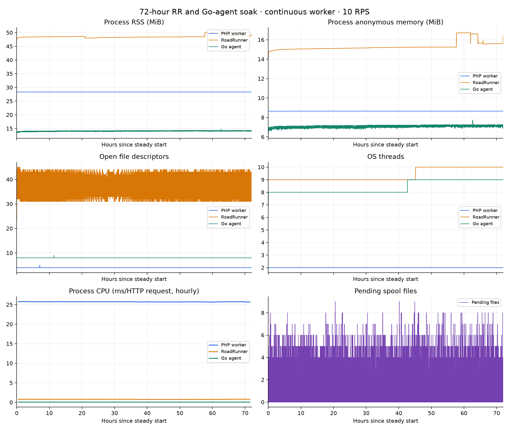
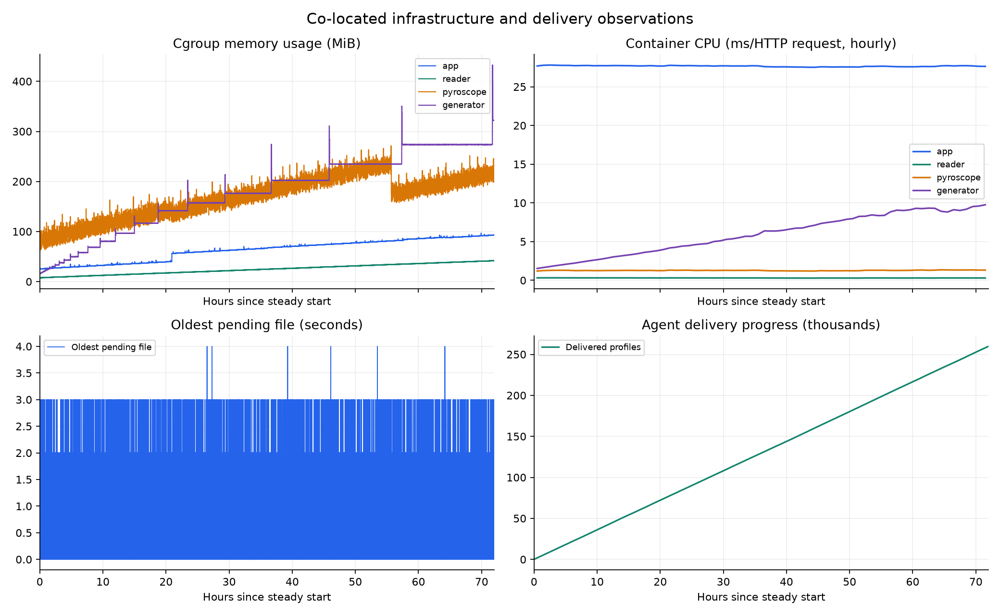

# RoadRunner and Go-agent 72-hour soak

Methodology follows [METHOD.md](../METHOD.md) and the
[observed-soak runbook](../docs/soak.md). Scope follows
[LIMITATIONS.md](../LIMITATIONS.md).

## Verdict

**PASS for this pinned single-worker RR and Go-agent scenario.** The load ran
continuously for 72 hours, maintained the requested 10 RPS, and finished with an
empty spool. Worker and container identities remained continuous. Load errors,
dropped iterations, writer failures, delivery retries and rejected profiles were
zero throughout the saved observations.

The PHP worker's memory and CPU per request stayed stable. The agent's first-hour
and last-hour mean RSS differed by 0.47 MiB, with a flat final-day trend. RoadRunner
retained less than 1 MiB additional RSS between those windows. Cgroup memory and
the co-located generator grew more substantially and are quantified below.

The [first attempt](2026-11-19-soak-observer-failure.md) remains **invalid** after
27.12 hours. It ended on a process-probe race before final drain. Its duration is
independent of this completed run. A concurrent-healthcheck reproduction, 500
corrected probes, a full pilot and a worker-replacement negative control preceded
the restart.

## Identity and configuration

| Field | Value |
| --- | --- |
| Steady window, UTC | 2026-11-19 08:47:24 to 2026-11-22 08:47:28 |
| Steady window, Moscow | 2026-11-19 11:47:24 to 2026-11-22 11:47:28 |
| Host | Ubuntu 26.04.1, Linux 7.0.0-43-generic, x86_64, QEMU virtual CPU, 2 vCPU, 3.8 GiB RAM, 48 GiB root disk, no swap |
| Docker / Compose | 29.1.3 / 2.40.3, cgroup v2, systemd, overlayfs |
| Benchmarks | `2fabb7d04d109fc9e89a636f0be5da60329e243c`, clean checkout |
| Tracewick | `dev-develop#55eb7bdb91cd4269a86bb0dd8ce22a243e5486b4` |
| Agent | `a15f0d310ba6d5942e67b37d3c3c55dc1b3b8100` |
| PHP / Excimer | 8.4.27 / 1.2.7, Excimer source `23f541b9d970db0524a1b2506b4df727e5e59998` |
| RoadRunner | 2025.1.15, one worker, 256 MiB worker memory supervisor |
| Pyroscope / k6 | 2.4.2 / 1.8.2, concrete image digests in identity and telemetry |
| Runtime / reader | RR / Go-agent, exactly one spool reader, shared spool, UID:GID 33:33 |
| Work unit | Depth 48, 25 ms busy work plus 10 ms sleep |
| Sampling / load | Sample rate 0.1, constant arrival rate 10/s, 20 preallocated / 40 maximum VUs |
| Phases | 5 min unprofiled baseline, 5 min profiling warmup, preflight drain, 72 h steady, final drain, 2 min cooldown |
| Collection | Requested 15 s sleep between observations, process and cgroup metrics collected independently |
| Limits | No container CPU or memory limits, RR worker supervisor retained |

App, reader and Pyroscope were verified to have separate cgroup scopes. All
published application and metrics ports were bound to loopback. Generator and
Pyroscope ran on the same host as the workload. Grafana was absent. Host services
included a monitoring agent. Host contention was observed through vmstat.

## Continuity and delivery

There are 16,166 steady snapshots. Their endpoint span is 259,185.50 seconds.
The phase boundary span is 259,203.15 seconds. The last observation precedes the
drain boundary by about 17.7 seconds, consistent with interval collection.
Mean observation spacing was 16.03 seconds and the largest gap was 17.11 seconds.
Collection time is additional to the requested 15-second sleep.

The raw data were independently replayed through the continuity validator.
PHP, RR and agent each retained one PID/start-tick identity during steady. Each
container, including the steady generator, retained one identity with zero
restarts. The intentional app recreation between baseline and warmup is recorded
separately in identity.json. Enabled profiling, sample rate, depth and worker
count were verified throughout steady.

| Observation | Result |
| --- | ---: |
| Completed steady work iterations | 2,592,001 |
| Steady HTTP requests, including one setup health request | 2,592,002 |
| Achieved work iterations/s from final k6 summary | 9.99996 |
| HTTP failures / dropped iterations | 0 / 0 |
| HTTP p50 / p95 / p99 / max | 36.86 / 37.39 / 38.43 / 73.51 ms |
| Agent deliveries between steady observation endpoints | 259,758 |
| Total delivered by end of cooldown, including warmup | 260,056 |
| Final RR collected / spooled profiles | 260,056 / 260,056 |
| Delivery retries / rejected profiles | 0 / 0 |
| Peak observed pending files / bytes / age | 9 / 19,329 / 4 s |
| Final pending files / rejected files | 0 / 0 |

One extra iteration at the arrival deadline is within the predeclared one-iteration
boundary tolerance. The final k6 summary covers the full load phase. Interval
request and delivery deltas omit the phase edges and therefore differ from full
phase totals. All observed RR drop, skip, reject, failure and sampler-error
diagnostics were zero. Drain returned after its first empty observation, in
0.29 seconds. All eight cooldown observations retained an empty spool.

## Process resources

Memory values below compare the first and last hour of steady observations.
CPU uses cumulative process counters divided by completed k6 HTTP requests in
the same window. RSS counts each process's shared mappings.

| Process | RSS first / last hour, MiB | Anonymous first / last hour, MiB | RSS trend, KiB/h | CPU first / last hour, ms/request |
| --- | ---: | ---: | ---: | ---: |
| PHP worker | 28.308 / 28.316 | 8.640 / 8.648 | +0.05 | 25.737 / 25.679 |
| RoadRunner | 48.133 / 48.855 | 14.764 / 15.613 | +12.16 | 0.753 / 0.801 |
| Go agent | 13.642 / 14.107 | 6.736 / 7.095 | +3.94 | 0.0667 / 0.0682 |

Trends are least-squares slopes over the whole steady series. PHP's final-day
RSS and anonymous slopes were zero. The agent's final-day slopes were both
approximately -0.10 KiB/h. RR's final-day RSS slope was +29.83 KiB/h. Its small
retention trend warrants continued interpretation in longer or different-workload
experiments. This experiment does not establish an allocator-level explanation.

| Process | FD last / maximum | OS threads first-hour mean / last / maximum | RSS after cooldown, MiB |
| --- | ---: | ---: | ---: |
| PHP worker | 4 / 5 | 2 / 2 / 2 | 28.316 |
| RoadRunner | 38 / 45 | 9 / 10 / 10 | 48.605 |
| Go agent | 8 / 9 | 7.98 / 9 / 9 | 12.324 |

Descriptors fluctuate within small ranges. Thread counts have small step changes.
Go OS threads do not measure goroutines. Go heap metrics were unavailable.



## Containers, generator and observer

| Container | Mean cgroup memory first / last hour, MiB | Mean CPU, vCPU | CPU first / last hour, ms/request |
| --- | ---: | ---: | ---: |
| RR app | 25.69 / 92.57 | 0.277 | 27.685 / 27.634 |
| Go agent | 7.86 / 41.43 | 0.003 | 0.317 / 0.299 |
| Pyroscope | 83.82 / 217.74 | 0.013 | 1.205 / 1.319 |
| k6 | 19.17 / 293.64 | 0.059 | 1.535 / 9.759 |

Cgroup usage includes kernel and file memory. App anonymous memory changed from
23.40 to 24.27 MiB and file memory from 0.09 to 17.19 MiB. Reader anonymous memory
changed from 6.74 to 7.09 MiB while file memory remained zero.

A separate post-run memory.stat snapshot found 50.04 MiB app and 33.85 MiB reader
slab_reclaimable. These kernel-accounted values explain a substantial part of the
remaining cgroup usage at that later instant. Kernel/slab time series were absent
from the collector, so the snapshot cannot identify the cause or precise timeline
of that growth. The cgroup increase must remain visible when interpreting this
experiment.

k6 anonymous memory and CPU/request increased across the run. Its trend summaries
retain samples, and repeated cumulative REST quantile checkpoints add generator
work. This harness does not isolate the contribution of each mechanism. The host
retained headroom, with 80.9% mean CPU idle in vmstat. Baseline p95/p99 were
37.14/38.13 ms and steady p95/p99 were 37.39/38.43 ms. Different window lengths and
generator lifecycles limit interpretation of that comparison as profiler overhead.

The Python observer's sampled median RSS was 27.69 MiB and sampled mean CPU was
0.066% of one CPU. These figures exclude its transient child processes. Container
CPU includes observer execs and healthchecks. GNU time recorded 500.96 MiB peak
RSS for the timed command and its child resource accounting, including final
postprocessing. That peak is consistent with loading the complete history during
analysis. The full analysis has memory usage proportional to the saved history.



## Evidence and reproduction

The [evidence directory](2026-11-22-soak-rr-agent-72h/) includes compressed original
telemetry and CSV, phase events, per-phase k6 summaries, runner result, hourly
summaries, an independent analysis, figures and the post-run cgroup snapshot.
All 14 original run files were copied locally and verified against SHA256 values
collected from the VPS. The published identity omits the host's uname hostname.
The exact original identity, runner scripts, host inventory and observer logs are
retained in the verified local archive. The first failed attempt is also retained
locally with its original invalid verdict and reproduction trace.

Recompute the numerical audit with Python 3 from the repository root.

```bash
python3 reports/2026-11-22-soak-rr-agent-72h/analyze.py
# Requires Matplotlib for figures.
python3 reports/2026-11-22-soak-rr-agent-72h/plot.py
```

The evidence SHA256SUMS covers published files. raw-SHA256SUMS covers the original
VPS run files. Decompress telemetry.jsonl.gz or resource-series.csv.gz before
checking their original hashes. identity.json is intentionally redacted, so its
published hash differs from the original identity hash.

This completes the continuous 72-hour depth-48 RR/agent observation on these pins.
The result is bounded by one synthetic workload, one worker and one host. It does
not establish leak freedom for all inputs, maximum throughput, FPM/Swoole/Messenger
behavior, symbol-share accuracy, chaos resilience or production readiness.
