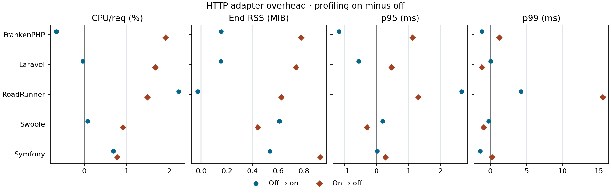

# HTTP adapter overhead — 2026-11-27

[Methodology](../METHOD.md) · [Limitations](../LIMITATIONS.md) · [Runner](../scripts/adapter-overhead/README.md)

## Scope

This campaign compares profiling off and on within five HTTP configurations.
The PSR-15 fixtures follow the sequential RoadRunner and FrankenPHP examples
and the continuous Swoole lifecycle. The Symfony bundle and Laravel service
provider run with their real HTTP kernels through a minimal RoadRunner HTTP
bridge. The framework fixtures reuse one booted kernel. Laravel Octane,
Symfony Messenger, Artisan and queue workers are outside this campaign.

| Input | Pin |
| --- | --- |
| Benchmark base | `a5495a5d6d73c7a7f6bd4c5f6c592165464d3c61` |
| PSR-15 develop | `bb4dd1629231cdf167247399c72c751d40e06dfd` |
| Symfony bundle develop | `1bb2f2678bed6cba75a2635b95faa2fdb7a04db4` |
| Laravel adapter develop | `bb93ad08efcfb732b95745b3d491aa2f622987c2` |
| Tracewick core | `v1.0.0-rc.1`, `110a65061c2ee61c4f44e09767cd7ee2e53b2a76` |
| Frameworks | Symfony FrameworkBundle 8.1.12 (HTTP components 8.1.13) and Laravel 13.44.1 |
| RoadRunner | 2025.1.15, PHP CLI 8.5.12 NTS |
| FrankenPHP | 1.14.0, PHP 8.5.13 ZTS |
| Swoole | 6.3.0, PHP 8.5.13 NTS |
| Excimer | 1.2.7, source `23f541b9d970db0524a1b2506b4df727e5e59998` |
| k6 | `grafana/k6:1.8.2@sha256:00fdcebafbc86cb0137d429529b1caa401a02e09025f02fc74866fa6e2b004d8` |
| Host | Managed cloud Linux 6.18.57, AMD EPYC 9V74, task cgroup 2 CPU quota and 8 GiB maximum RAM |
| Local image IDs | [Identity](2026-11-27-adapter-http-overhead/identity.json) |
| Dependencies | [PSR-15 example pins](2026-11-27-adapter-http-overhead/psr-dependencies.json) · [Symfony lock](../scripts/adapter-overhead/symfony/composer.lock) · [Laravel lock](../scripts/adapter-overhead/laravel/composer.lock) |

## Workload and measurement

- The pilot calibrated RoadRunner with profiling off. The campaign holds
  **2,600,000 integer operations** at stack depth 24 for every request, with
  expected checksum `1396360769`. Every response must return that operation
  count and checksum plus the expected PHP process ID.
- k6 drives **20 requests/s**, with 10 preallocated and up to 20 VUs. Per arm
  use a fresh stand container, 20 seconds of settling under load and 60 seconds
  of measurement. Two pairs reverse order: off → on, then on → off. Run arms
  sequentially on the same managed host.
- The sequential profilers use request sample rate `0.1` and local spool.
  Swoole samples continuously, with 15-second aggregation windows and one
  post-response pulse per second while requests arrive. Both states load the
  same extensions. The off state skips profiling registration.
- CPU is the change in worker user and system process ticks divided by complete
  measured requests. Capture worker identity and RSS at both endpoints.
  FrankenPHP shares its PHP process with Caddy, so its CPU and RSS include
  the server. RoadRunner process counters cover the PHP worker. Swoole
  counters cover the PHP HTTP worker process. Host and generator scheduling
  contribute to the measured wall latency.
- The stand retains written files in 128 MiB tmpfs. The 64 MiB free-space
  reserve preserves spool admission. Spool presence is checked in every arm.
  The writer runs locally and the experiment exercises no drain or backend.

## Measurements

The second table shows the range of the two within-pair on-minus-off deltas.
These are observed ranges for the pinned workload and environment.
[Machine-readable measurements](2026-11-27-adapter-http-overhead/measurements.json)

| Runtime | Pair | Profiling | Requests | CPU ms/req | RSS start → end, MiB | p50 / p95 / p99, ms | Spool files |
| --- | ---: | --- | ---: | ---: | ---: | ---: | ---: |
| franken | 1 | off | 1201 | 15.71 | 86.29 → 87.29 | 14.86 / 18.42 / 22.99 | 0 |
| franken | 1 | on | 1200 | 15.61 | 86.66 → 87.45 | 14.89 / 17.25 / 21.78 | 163 |
| franken | 2 | on | 1201 | 15.46 | 87.07 → 88.07 | 14.70 / 17.74 / 21.41 | 151 |
| franken | 2 | off | 1201 | 15.17 | 86.39 → 87.30 | 14.35 / 16.61 / 20.17 | 0 |
| laravel | 1 | off | 1201 | 23.58 | 44.01 → 44.01 | 23.97 / 26.71 / 29.93 | 0 |
| laravel | 1 | on | 1201 | 23.57 | 44.16 → 44.16 | 23.98 / 26.15 / 29.96 | 159 |
| laravel | 2 | on | 1201 | 23.75 | 44.50 → 44.50 | 24.06 / 26.48 / 29.07 | 156 |
| laravel | 2 | off | 1201 | 23.36 | 43.77 → 43.77 | 23.78 / 26.01 / 30.29 | 0 |
| rr | 1 | off | 1201 | 22.79 | 29.32 → 29.18 | 23.41 / 26.65 / 30.88 | 0 |
| rr | 1 | on | 1201 | 23.30 | 29.96 → 29.16 | 23.97 / 29.30 / 35.11 | 150 |
| rr | 2 | on | 1201 | 23.24 | 29.88 → 29.76 | 23.46 / 30.70 / 54.70 | 156 |
| rr | 2 | off | 1201 | 22.90 | 29.13 → 29.13 | 23.41 / 29.40 / 39.14 | 0 |
| swoole | 1 | off | 1201 | 20.59 | 33.76 → 33.67 | 20.43 / 23.28 / 27.43 | 0 |
| swoole | 1 | on | 1201 | 20.61 | 34.41 → 34.28 | 20.15 / 23.47 / 27.16 | 6 |
| swoole | 2 | on | 1201 | 20.34 | 34.29 → 34.24 | 20.12 / 22.03 / 24.35 | 5 |
| swoole | 2 | off | 1201 | 20.16 | 33.89 → 33.80 | 19.98 / 22.33 / 25.27 | 0 |
| symfony | 1 | off | 1201 | 23.17 | 46.84 → 46.75 | 23.81 / 26.39 / 30.09 | 0 |
| symfony | 1 | on | 1201 | 23.33 | 47.39 → 47.28 | 23.91 / 26.41 / 28.70 | 185 |
| symfony | 2 | on | 1201 | 22.76 | 47.32 → 47.27 | 23.53 / 26.08 / 28.75 | 150 |
| symfony | 2 | off | 1201 | 22.59 | 46.41 → 46.35 | 23.37 / 25.81 / 28.54 | 0 |

| Runtime | CPU/req delta | RSS at end delta | p95 delta | p99 delta |
| --- | ---: | ---: | ---: | ---: |
| franken | -0.66 to +1.92 % | +0.16 to +0.78 MiB | -1.17 to +1.13 ms | -1.21 to +1.24 ms |
| laravel | -0.04 to +1.68 % | +0.15 to +0.74 MiB | -0.56 to +0.47 ms | -1.22 to +0.03 ms |
| rr | +1.49 to +2.23 % | -0.03 to +0.62 MiB | +1.30 to +2.65 ms | +4.23 to +15.55 ms |
| swoole | +0.08 to +0.91 % | +0.44 to +0.61 MiB | -0.30 to +0.18 ms | -0.92 to -0.27 ms |
| symfony | +0.68 to +0.77 % | +0.54 to +0.93 MiB | +0.02 to +0.28 ms | -1.39 to +0.20 ms |

## Findings

- All 20 measurement windows completed. k6 validated 24,019 measured HTTP
  responses, with zero dropped iterations, HTTP errors or checksum and PID
  mismatches. Enabled arms produced spool files. Disabled arms produced zero.
  Spool counts include the settling period.
- RoadRunner showed the clearest repeatable increase. Per-pair CPU rose
  1.49–2.23% and p95 rose 1.30–2.65 ms. The spread in p99 (+4.23 to
  +15.55 ms) warrants caution about the magnitude of the tail effect.
- Symfony showed +0.68 to +0.77% CPU and +0.02 to +0.28 ms p95.
  Swoole showed +0.08 to +0.91% CPU and a p95 delta that crossed zero.
  The CPU deltas for FrankenPHP and Laravel changed sign across their two
  pairs. The observed differences are small relative to between-run variation.
- End-of-window RSS differences ranged from −0.03 to +0.93 MiB across the
  ten pairs. This measures two endpoints per window. Long-term memory
  growth, multiworker capacity and backend delivery need their own experiments.
